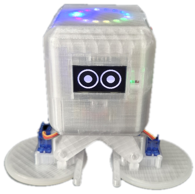
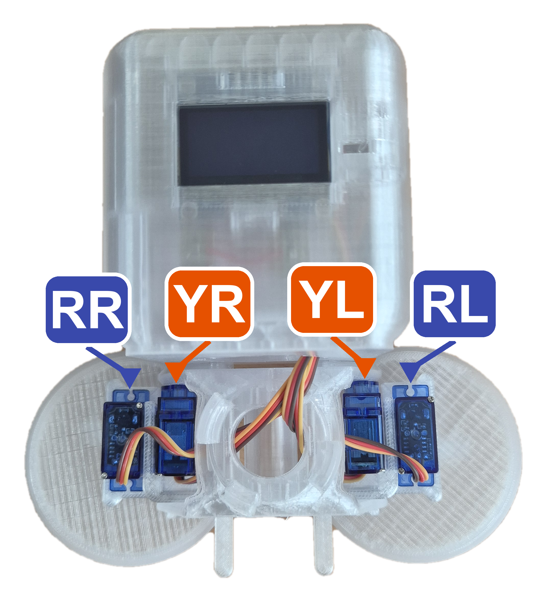

# Otto I2R Robot

[i2r-05](https://github.com/kdi6033/i2r-05) 보드(ESP32-S3)와 서보모터 4개로 만든 Otto 로봇의 문서 모음입니다.

 

## 서보모터 4개

| 이름 | 위치 | 연결 핀 | 서보 종류 |
|---|---|---|---|
| YL | 왼쪽 엉덩이 | 4 | 180도 각도조절 |
| YR | 오른쪽 엉덩이 | 5 | 180도 각도조절 |
| RL | 왼발 | 6 | 360도 연속회전 |
| RR | 오른발 | 7 | 360도 연속회전 |

## 시작 순서

1. 조립 후 **로봇 맞추기**(다리 수직, 두 바퀴 직진) → **걷기 보정**(걷기 기울기)
2. 보정값을 `config.h`에 적기
3. 걷기, 굴리기, 춤 등 동작 프로그램 실행

> 서보는 **배터리(외부 전원)** 로 구동하세요. USB 전원만 쓰면 서보가 동시에 움직일 때 전류가 부족해 보드가 재부팅될 수 있습니다.

## 문서

| 문서 | 내용 |
|---|---|
| [docs/guide.md](docs/guide.md) | 제작 가이드: 서보 이름과 핀, config.h, 보정, 걷기, 굴리기, 춤, OLED, LED, 센서 |
| [docs/protocol.md](docs/protocol.md) | 통신 프로토콜 v1.0 (초안): MQTT, BLE, 동작 명령, LLM 대화 |

> 이 문서는 i2r-05 저장소 README의 9장에서 옮겨 왔습니다. 예제 스케치와 펌웨어는 정리되는 대로 추가합니다.
