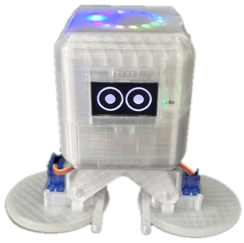
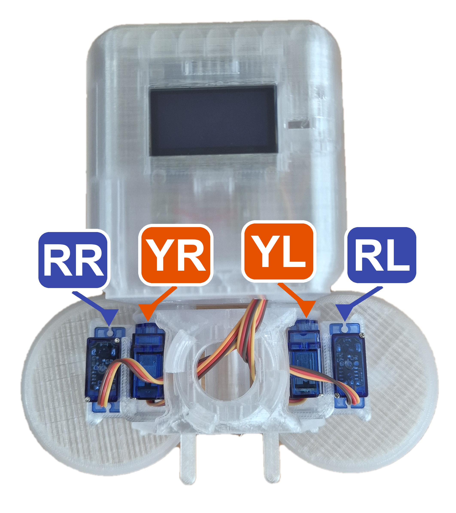

# Otto I2R Robot

**생성형 AI(Claude, Gemini, ChatGPT 등)와 함께 배우는 피지컬 AI 로봇**

[i2r-05](https://github.com/kdi6033/i2r-05) 보드(ESP32-S3)와 서보모터 4개로 만든 Otto 로봇의 문서 모음입니다.

&nbsp;&nbsp;&nbsp;&nbsp;&nbsp;&nbsp;&nbsp;&nbsp;&nbsp;&nbsp;&nbsp;&nbsp;&nbsp;&nbsp;

## 서보모터 4개

| 이름 | 위치 | 연결 핀 | 서보 종류 |
|---|---|---|---|
| YL | 왼쪽 엉덩이 | 4 | 180도 각도조절 |
| YR | 오른쪽 엉덩이 | 5 | 180도 각도조절 |
| RL | 왼발 | 6 | 360도 연속회전 |
| RR | 오른발 | 7 | 360도 연속회전 |

## 시작 순서

1. 조립 후 웹에서 **로봇 맞추기**(조립 자세, 다리 수직, 굴리기, 걷기 기울기)를 하고 **저장**
2. 걷기, 굴리기, 춤 등 동작 프로그램 실행 (저장한 값을 자동으로 불러옵니다)

> 서보는 **배터리(외부 전원)** 로 구동하세요. USB 전원만 쓰면 서보가 동시에 움직일 때 전류가 부족해 보드가 재부팅될 수 있습니다.

## AI와 함께 프로그램하기

이 저장소에는 **AI가 읽는 안내서**([AGENTS.md](AGENTS.md))가 들어 있습니다. 로봇의 핀, 함수, 지켜야 할 규칙이 정리되어 있어서, AI에게 이 저장소를 알려 주면 내 로봇에 맞는 프로그램을 만들어 줍니다.
두 가지 방법이 있습니다. 처음이라면 A부터 해 보세요.

| | 방법 A: 채팅 (초급용) | 방법 B: Claude Code (중급용) |
|---|---|---|
| 도구 | claude.ai (ChatGPT, Gemini도 가능) + Arduino IDE | VS Code + Claude Code |
| 하는 일 | AI가 코드를 주면 내가 복사해서 업로드 | AI가 코드 작성, 컴파일, 업로드까지 직접 |
| 오류가 나면 | 오류 메시지를 복사해서 AI에게 붙여 넣기 | AI가 스스로 고침 |
| 요금 | 무료 요금제로 시작 가능 | Claude 유료 요금제(Pro 이상) |
| 추천 | 처음 시작하는 사람 | 여러 기능을 만들어 보고 싶은 학생, 동호인 |

### 방법 A: claude.ai 채팅으로 하기 (초급용, 가장 쉬움)

**처음 한 번 준비**

1. [Arduino IDE 2](https://www.arduino.cc/en/software)를 설치합니다.
2. **보드 매니저**에서 `esp32 by Espressif Systems`(3.0 이상)를, **라이브러리 매니저**에서 `OttoI2R`을 설치합니다. ([가이드 1.2](docs/guide.md#-12-otto-i2r-robot-아두이노-라이브러리-설치))
3. **툴** 메뉴에서 보드 설정을 아래처럼 맞춥니다.

| 툴 메뉴 | 값 |
|---|---|
| 보드 | ESP32S3 Dev Module |
| USB CDC On Boot | Enabled |
| Flash Size | 16MB (128Mb) |
| PSRAM | OPI PSRAM |
| Partition Scheme | 16M Flash (3MB APP/9.9MB FATFS) |
| Erase All Flash Before Sketch Upload | **Disabled** (켜면 보정값이 지워집니다) |

**AI에게 말하기**

[claude.ai](https://claude.ai)를 열고 아래 문장을 복사해서 붙여 넣은 뒤, 마지막 줄만 내가 원하는 것으로 바꿉니다.

```
나는 Otto I2R 로봇을 가지고 있어.
먼저 https://raw.githubusercontent.com/kdi6033/otto/main/AGENTS.md 를 읽고, 거기 적힌 핀과 규칙과 함수만 써서 아두이노 코드를 만들어 줘.
나는 초보자니까 코드는 처음부터 끝까지 전체를 주고, 무엇을 하는 코드인지 쉽게 설명해 줘.

만들고 싶은 것: 앞으로 5걸음 걷고, LED를 초록색으로 켠 다음, 뒤로 5걸음 걸어 줘.
```

**반복하기**

1. 받은 코드를 Arduino IDE에 붙여 넣고 **업로드**합니다.
2. 오류가 나면 **오류 메시지 전체를 복사해서** AI에게 붙여 넣습니다.
3. 로봇이 원하는 대로 움직이지 않으면 **어떻게 움직였는지** 구체적으로 말합니다. (예: "오른쪽으로 휘면서 3걸음만 갔어")
4. 잘 되면 다음 기능을 덧붙입니다. (예: "이제 거리 센서로 장애물을 만나면 멈추게 해 줘")

> ChatGPT, Gemini에서도 같은 문장으로 쓸 수 있습니다. 주소를 읽지 못하는 AI라면 [AGENTS.md](AGENTS.md) 내용을 복사해서 함께 붙여 넣으세요.

### 방법 B: Claude Code로 하기 (중급용, AI가 업로드까지)

[](https://youtu.be/2xssJmEde6o) [**전문가의 지식을 통째로 넣어 AI 프로그램**](https://youtu.be/2xssJmEde6o)

내가 설치하는 것은 **Git, VS Code, Claude Code 확장** 3개뿐입니다. 빈 폴더를 VS Code로 열고 Claude에게 아래처럼 말하면, 저장소 내려받기와 컴파일 도구·라이브러리 설치까지 Claude가 합니다.

```
https://github.com/kdi6033/otto 저장소를 이 폴더에 내려받고,
그 안의 CLAUDE.md를 읽은 다음 Otto 개발 환경을 만들어 줘.
```

그다음부터는 Claude가 [CLAUDE.md](CLAUDE.md)를 읽고 **코드 작성, 컴파일, 업로드, 시리얼 확인**까지 직접 합니다.
나는 원하는 동작을 말하고, 로봇이 어떻게 움직였는지 알려 주기만 하면 됩니다.

```
나: "거리 센서로 15cm 안에 손이 오면 뒤로 물러나고 LED를 빨간색으로 켜 줘"
Claude: 프로그램 작성 → 컴파일 → 업로드 → "로봇이 뒤로 물러났나요?"
```

설치부터 첫 업로드까지는 **[Claude Code로 시작하기](docs/claude-code.md)** 를 따라 하세요.

## 문서

| 문서 | 내용 |
|---|---|
| [docs/guide.md](docs/guide.md) | 제작 가이드: 서보 이름과 핀, 로봇 맞추기, 걷기, 굴리기, 춤, OLED, LED, 센서 |
| [docs/claude-code.md](docs/claude-code.md) | Claude Code로 시작하기: 설치, 첫 업로드, 대화 요령 |
| [AGENTS.md](AGENTS.md) | AI용 안내서: 하드웨어, 규칙, 함수 목록, 컴파일과 업로드 방법 |
| [examples/](examples/) | 장치와 응용 예제 (서보 원리, OLED, LED, 거리·조도 센서, 웹서버). 동작 예제는 [OttoI2R 라이브러리](https://github.com/kdi6033/OttoI2R/tree/main/examples)에 있습니다 |
| [docs/protocol.md](docs/protocol.md) | 통신 프로토콜 v1.0 (초안): MQTT, BLE, 동작 명령, LLM 대화 |

> AI 도구별 안내 파일: Claude Code는 [CLAUDE.md](CLAUDE.md), Codex·Cursor 등은 [AGENTS.md](AGENTS.md), 웹 채팅 AI는 [llms.txt](llms.txt)를 읽습니다. 내용은 모두 AGENTS.md를 기준으로 합니다.
