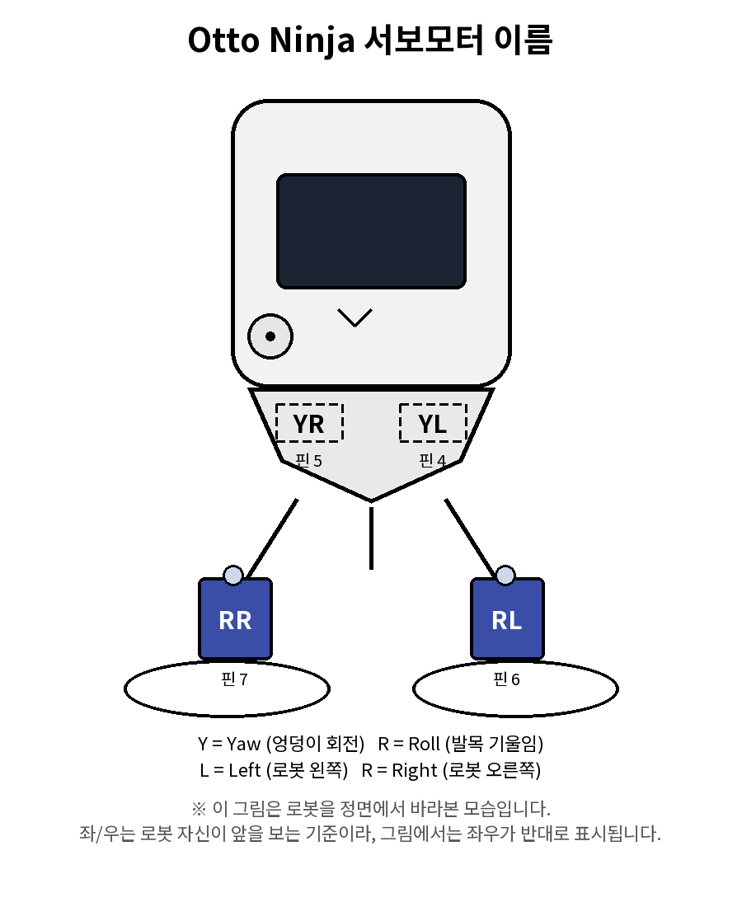

# Otto I2R Robot 제작 가이드

> 사용 보드: [i2r-05](https://github.com/kdi6033/i2r-05) (ESP32-S3). 통신 규격은 [protocol.md](protocol.md)를 참고하세요.


✅  1. 서보모터 이름, 역할, 연결 핀

Otto I2R는 서보모터 4개로 걷습니다. 이름은 **[관절 종류][좌/우]** 2글자 규칙으로 짓습니다. 이렇게 하면 이름만 보고도 "어떤 동작을 하는 서보인지"와 "왼쪽인지 오른쪽인지"를 바로 알 수 있습니다.

보드의 4, 5, 6, 7번 핀을 사용하며, `Otto.init()` 함수의 인자 순서(`YL, YR, RL, RR`)와 동일하게 번호를 맞춰서 헷갈리지 않도록 합니다.

| 이름 | 뜻 | 위치 | 연결 핀 | 서보 종류 | 하는 일 |
|---|---|---|---|---|---|
| **YL** | Yaw Left | 왼쪽 엉덩이 | 4 | 180도 각도조절 | 다리를 좌우로 기울여 무게중심을 이동시킴 (반대쪽 발을 바닥에서 뜨게 함) |
| **YR** | Yaw Right | 오른쪽 엉덩이 | 5 | 180도 각도조절 | 다리를 좌우로 기울여 무게중심을 이동시킴 (반대쪽 발을 바닥에서 뜨게 함) |
| **RL** | Roll Left | 왼쪽 발 | 6 | 360도 연속회전 | 발을 굴려서 실제로 앞으로 내딛음 (걸음을 만드는 동작) |
| **RR** | Roll Right | 오른쪽 발 | 7 | 360도 연속회전 | 발을 굴려서 실제로 앞으로 내딛음 (걸음을 만드는 동작) |



> 이 이름은 Otto DIY 공식 아두이노 라이브러리(`Otto.h`)의 명명 규칙과 동일합니다. 같은 이름을 쓰면 공식 예제 코드와 튜토리얼을 그대로 참고할 수 있어 편리합니다.

> ⚠️ **좌/우 기준**: 사람이 로봇을 마주 보는 방향이 아니라, **로봇이 스스로 앞을 바라보는 방향**을 기준으로 왼쪽/오른쪽을 정합니다. 즉 로봇과 마주 서면 사람 눈에는 좌우가 반대로 보입니다.

-------

✅  2. 프로젝트 구조

이 프로젝트는 세 부분으로 나뉩니다.

| 위치 | 내용 | 누가 다루는가 |
|---|---|---|
| **GitHub 저장소** | 동작 프로그램 여러 개(약 50개) | 사용자가 주소만 알려 줌 |
| **OttoI2R 라이브러리** | 걷기, 회전, 정지 등 실제 동작 코드 | 정교한 조작이 필요할 때 변수를 수정 |
| **config.h** | 로봇마다 다른 보정값 | 누구나 숫자만 채움 |

**프로그램을 만들 때는 AI에게 **저장소 주소나 참고할 유튜브 주소**를 알려 주면 됩니다. AI가 저장소의 동작 예제와 라이브러리를 보고 새 프로그램을 만들어 줍니다.**

**config.h의 역할**

`config.h`는 **이 로봇만의 보정값을 모아 둔 파일**입니다. 같은 프로그램이라도 로봇마다 조립 상태가 달라서 값이 다르기 때문에, 프로그램 코드와 분리해 두었습니다.

- **프로그래머가 최소한으로 입력하는 곳**입니다. 프로그램 코드를 고치지 않고 숫자만 바꿔도 로봇이 보정됩니다.
- 값을 바꾸고 다시 업로드하면 동작이 바뀝니다.
- 로봇을 새로 조립하거나 패드를 붙이면 이 파일의 값을 다시 맞춥니다.


<br>     
<details>
    <summary>💻 config.h </summary>

```c
#pragma once
// 이 로봇의 보정값 - 로봇마다 실측해서 채운다.
// "기준값"은 로봇을 처음 조립했을 때 일반적으로 이 근처에서 시작해서 맞추면 되는 값이다.

// ============================================================
// [1] ottoCalibrationRolling() - 360도 회전 테스트에서 쓰는 값
//     두 바퀴(RL, RR)가 동시에 같은 속도로 돌 때 똑바로 가는지 확인한다.
// ============================================================

// 다리(YL, YR)가 정확히 수직(90도)이 되는 펄스폭(us).
// 기준값: 서보 사양상 0도=500us, 180도=2400us이니 산술 중심은 1450us.
// 물리적으로 다리를 0도 180도로 구르현태로 위치하고 나사를 조이고 다음 단계 진행하세요
// 다리가 수평(90도=1450us)하게 위치하고  아래값을 조정해서 수평을 맟추세요
const int YL_PULSE_CENTER = 1250;  // 실측값
const int YR_PULSE_CENTER = 1450;  // 실측값 (이 로봇은 우연히 기준값과 같음)

// 두 바퀴가 동시에 돌 때 전진 속도 오프셋(us).
// 기준값: 400~500us 사이에서 시작해서, 똑바로 가도록 좌우를 다르게 조정한다.
const int RL_SPEED_US = 450;
const int RR_SPEED_US = 550;

// ============================================================
// [2] ottoCalibrationWalk() - 걷기 테스트에서 쓰는 값
//     오른발 -> 왼발 번갈아 한 걸음씩 내딛는다.
//     ⚠️ 위 [1]과 물리적으로 동작 방식이 달라서 값을 공유하면 안 된다.
// ============================================================

// 그쪽 발을 들 때 기울이는 각도.
// 기준값: 20도에서 시작 - 로봇이 안 들리면 올리고, 한쪽으로 돌면 그쪽을 더 올린다.
const int TILT_OFFSET_R = 20;  // 오른발을 들 때
const int TILT_OFFSET_L = 23;  // 왼발을 들 때

// 걷는 속도·보폭(WALK_RL/RR_SPEED_US, TILT_TIME, STEP_TIME 등)은
// OttoI2R 라이브러리(OttoI2R.cpp) 안에 들어있다.
// 걷는 모양이나 속도를 바꾸고 싶으면 그 파일에서 수정한다.

// ============================================================
// 보정값 자동 등록
// 이 파일을 #include 하면 위의 보정값이 라이브러리에 자동으로 저장된다.
// 프로그램에서 값을 따로 넘길 필요가 없다. (서보는 여기서 움직이지 않는다)
// ============================================================
#include <OttoI2R.h>

struct OttoCalibrationRegister {
  OttoCalibrationRegister() {
    ottoSetCalibration(YL_PULSE_CENTER, YR_PULSE_CENTER, TILT_OFFSET_R, TILT_OFFSET_L, RL_SPEED_US, RR_SPEED_US);
  }
};
static OttoCalibrationRegister ottoCalibrationRegister;


```
</details>


동작 프로그램을 여러 개(50개 정도) 만들어 GitHub에 올려 두고, 저장소 주소를 알려 주면 Claude가 그것을 참조해서 새 동작을 만들 수 있게 하려는 구조입니다.

**프로그램 함수 목록**

| 번호 | 이름 | 설명 | 사용 모터 | 주요 튜닝 값 |
|---|---|---|---|---|
| 00 | callibration_rolling | 조립 후 다리 수직, 두 바퀴 직진 확인 | YL YR RL RR | YL_PULSE_CENTER, YR_PULSE_CENTER, RL_SPEED_US, RR_SPEED_US |
| 01 | callibration_walk | 걷기 기울기 맞추기 | YL YR RL RR | TILT_OFFSET_R, TILT_OFFSET_L |
| 02 | walk_front | 앞으로 걷기 | YL YR RL RR | TILT_OFFSET_R, TILT_OFFSET_L, RL_SPEED_US, RR_SPEED_US |
| 03 | walk_back | 뒤로 걷기 | YL YR RL RR | TILT_OFFSET_R, TILT_OFFSET_L, RL_SPEED_US, RR_SPEED_US |
| 04 | walk_left | 걸으면서 왼쪽으로 돌기 | YL YR RL RR | TILT_OFFSET_R, RL_SPEED_US, RR_SPEED_US |
| 05 | walk_right | 걸으면서 오른쪽으로 돌기 | YL YR RL RR | TILT_OFFSET_L, RL_SPEED_US, RR_SPEED_US |
| 06 | slide_front | 좌우 교대로 부드럽게 움직이기 | YL YR RL RR | TILT_OFFSET_R, TILT_OFFSET_L, RL_SPEED_US, RR_SPEED_US |
| 07 | slide_back | 좌우 교대로 부드럽게 뒤로 움직이기 | YL YR RL RR | TILT_OFFSET_R, TILT_OFFSET_L, RL_SPEED_US, RR_SPEED_US |
| 08 | slide_right | 왼발 반시계, 오른발 시계로 동시에 돌기 | YL RL RR | TILT_OFFSET_L, RL_SPEED_US, RR_SPEED_US |
| 09 | slide_left | 오른발 반시계, 왼발 시계로 동시에 돌기 | YR RL RR | TILT_OFFSET_R, RL_SPEED_US, RR_SPEED_US |
| 10 | rolling_front | 발을 멈추지 않고 앞으로 굴리기 | YL YR RL RR | RL_SPEED_US, RR_SPEED_US |
| 11 | rolling_back | 발을 멈추지 않고 뒤로 굴리기 | YL YR RL RR | RL_SPEED_US, RR_SPEED_US |
| 12 | rolling_right | 제자리에서 오른쪽으로 계속 돌기 | YL YR RL RR | RL_SPEED_US, RR_SPEED_US |
| 13 | rolling_left | 제자리에서 왼쪽으로 계속 돌기 | YL YR RL RR | RL_SPEED_US, RR_SPEED_US |
| 14 | hip_sweep | 시리얼로 엉덩이 각도 입력하기 (`moveHip(yr, yl)`) | YR YL | 입력한 각도 (0~180, 90이 가운데) |
| 15 | roll_one_foot | 발을 하나씩 앞, 뒤로 굴리기 (`rollRightFoot`, `rollLeftFoot`) | RR RL | 최고 속도 **+400** (앞으로 가장 빠름), 최저 속도 **-400** (뒤로 가장 빠름), 0은 멈춤 |

> 주요 튜닝 값은 모두 `config.h`에 있습니다. 학생은 보정 프로그램(00, 01)에서 맞춘 값을 그대로 씁니다.    
---

✅  3. 조립 후 모터 동작 확인과 초기셋

로봇의 모터마다 동작이 조금씩 다르고 바다면에서 기계적으로 미끄럼이 발생함으로 지기진시 똑바로 굴러가고 걸어가도록 보정을 해줘야 동작이 정확 합니다. 그래도 바닥의 접촉면과 마찰의 힘이 달라서 프로그램 하면서 보정해 주세요.   
1. 다리가 90도로 접히도록 보정.
2. 앞으로 직진하여 굴러가도록 RR RL 모터의 회전속도 보정.
3. 앞으로 똑바로 걸어 가도록 YR YL 의 각도로 보폭을 보정.

✅ 3.1 회전 보정 (callibration_rolling)    

Otto I2R 로봇의 **다리 수직 맞춤**과 **두 바퀴 직진 맞춤**을 확인하고 조정하는 프로그램입니다. 프로그램 코드는 수정하지 않고, `config.h`의 숫자 4개만 고칩니다.   

**파일 구성**

| 파일 | 역할 |
|---|---|
| `callibration_rolling.ino` | 메인 프로그램. `ottoInit()`으로 초기화한 뒤 `ottoCalibrationRolling()`을 계속 실행합니다. |
| `config.h` | 보정값 모음. 로봇마다 이 파일의 값을 실측해서 채웁니다. |

라이브러리 `OttoI2R`(`OttoI2R.cpp`) 안에 실제 동작 코드가 들어 있습니다. 이 프로그램은 값만 넣어서 호출합니다.

**고칠 값 (config.h)**

| 상수 | 의미 | 기준값 | 로봇별 실측값 |
|---|---|---|---|
| `YL_PULSE_CENTER` | 왼쪽 다리가 **수직(90도)** 이 되는 펄스폭(us) | 1450 | 1250 |
| `YR_PULSE_CENTER` | 오른쪽 다리가 **수직(90도)** 이 되는 펄스폭(us) | 1450 | 1450 |
| `RL_SPEED_US` | 왼발 회전 속도 오프셋(us). 클수록 빠름 | 400~500 | 450 |
| `RR_SPEED_US` | 오른발 회전 속도 오프셋(us). 클수록 빠름 | 400~500 | 550 |

> `config.h`의 **[2] 걷기 테스트** 값(`TILT_OFFSET_R`, `TILT_OFFSET_L`)은 이 프로그램에서 쓰지 않습니다. 걷기 보정은 별도 `callibration_walk`에서 합니다. 두 값을 공유하지 마세요.

**보정 순서**

**1단계: 다리 수직 맞추기 (YL, YR)**

다리가 몸체에 대해 수직(90도)이어야 로봇이 바닥에 평평하게 섭니다.

1. `config.h`의 `YL_PULSE_CENTER`, `YR_PULSE_CENTER`를 기준값 1450으로 두고 업로드합니다.
2. 전원을 켜면 엉덩이 서보가 중립 위치로 이동합니다. 다리가 바닥과 수직인지 자와 수평계로 확인합니다.
3. 다리가 기울어 있으면 해당 값을 조금씩 바꿉니다.
   - 1450에서 **작은 값**으로 줄이면 다리가 한쪽 방향으로 움직입니다.
   - 값을 바꾸고 다시 업로드하면서 수직이 될 때까지 반복합니다.
4. 수직이 맞으면 조립 나사를 조입니다. 나사를 조인 뒤에 다리가 다시 틀어지지 않는지 확인합니다.

> 로봇마다 기계 조립 상태가 달라서 두 다리의 중심값이 같지 않을 수 있습니다. 이 로봇은 왼쪽 1250, 오른쪽 1450으로 실측했습니다.

**2단계: 두 바퀴 직진 맞추기 (RL, RR)**

두 발을 같은 속도로 굴렸을 때 로봇이 똑바로 가는지 확인합니다.

1. 로봇을 **바닥의 직선 자리**(예: 탁자 위 긴 줄을 따라)에 놓습니다.
2. 업로드 후 프로그램이 계속 굴러갑니다. 전원을 끄거나 보드의 리셋 버튼을 눌러 멈춥니다.
3. 로봇이 한쪽으로 돌면 **느린 쪽이 돌아가는 방향**이 됩니다. 따라서 다음처럼 조정합니다.
   - 로봇이 **왼쪽**으로 휘면 왼발이 느린 것이므로 `RL_SPEED_US`를 키웁니다.
   - 로봇이 **오른쪽**으로 휘면 오른발이 느린 것이므로 `RR_SPEED_US`를 키웁니다.
4. 한 번에 **20~50us 이내**로만 바꿉니다. 값을 크게 바꾸면 방향이 반대로 넘어가기 쉽습니다.
5. 직진이 될 때까지 반복합니다. 약 1m 거리를 두 번 이상 확인하세요.

> 방향이 반대로 휘면 값을 되돌리거나, 바꾼 쪽을 반대로 조정하세요. 어느 쪽이 느린지 확실하지 않으면 한쪽만 조금 바꿔서 결과를 보는 것이 가장 빠릅니다.

**동작 순서**

1. **YL, YR (엉덩이)**: 90도 기준으로 좌우 30도씩(60도 → 120도) 움직인 뒤 90도로 복귀합니다. 복귀 후 3초 쉬는 동안 평평한 탁자에 다리를 대고 나사를 조여 수평을 맞춥니다.
2. **RR (7번 핀)**: 정회전 → 정지 → 역회전 → 정지
3. **RL (6번 핀)**: 정회전 → 정지 → 역회전 → 정지
4. 모든 모터를 멈추고 종료합니다. 다시 하려면 보드의 리셋 버튼을 누릅니다.

<br>     
<details>
    <summary>💻 회전 보정 (callibration_rolling.ino) </summary>

```c
#include <OttoI2R.h>
#include "config.h"

// 서보 테스트: 다리가 수직인지, 똑바로 전진/후진하는지 확인하는 프로그램.
// 고칠 건 config.h 안의 숫자뿐이다.

void setup() {
}

void loop() {
  ottoCalibrationRolling();
}
```
</details>

----
✅ 3.2 걷기 보정 (callibration_walk)

Otto I2R 로봇이 **똑바로 걷도록** 발을 드는 각도를 맞추는 보정 프로그램입니다. 프로그램 코드는 수정하지 않고, `config.h`의 숫자만 고칩니다.

오른발과 왼발을 번갈아 한 걸음씩 내딛습니다. 걷는 속도와 보폭은 `OttoI2R` 라이브러리 안에 있으므로 이 프로그램에서는 다루지 않습니다.

**config.h에서 쓰는 값**

이 프로그램은 `config.h`의 두 묶음을 사용합니다.

**걷기 기울기 보정 값 (걷기 동작에 사용)**

| 상수 | 의미 | 기준값 | 이 로봇 실측값 |
|---|---|---|---|
| `TILT_OFFSET_R` | 오른발을 들 때 기울이는 각도 | 20 | 20 |
| `TILT_OFFSET_L` | 왼발을 들 때 기울이는 각도 | 20 | 23 |

> `config.h`의 **[1] 회전 테스트 값** 중 `RL_SPEED_US`, `RR_SPEED_US`는 이 프로그램에서 쓰지 않습니다. 회전 보정은 `callibration_rolling`에서 합니다.

**보정 순서**

걷기 보정은 **회전 보정을 먼저 끝낸 뒤**에 합니다. 다리 수직과 두 바퀴 직진이 맞지 않은 상태에서 걸으면 기울기 값이 잘못 잡힙니다.

1. 로봇을 **평평한 바닥**(실제로 걸을 바닥)에 놓고 업로드합니다.
2. 걷는 모습을 보고 아래 기준으로 기울기 값을 조정합니다.

**기울기 조정 기준**

| 관찰 | 조정 |
|---|---|
| 발이 바닥에서 들리지 않음 | 해당 발의 `TILT_OFFSET`을 키움 |
| 발이 너무 높이 들려 몸이 흔들림 | 해당 발의 `TILT_OFFSET`을 줄임 |
| 한쪽으로 자꾸 돎 | 돌아가는 쪽 발의 `TILT_OFFSET`을 키움 |
| 한쪽 발만 걸음이 짧음 | 그 발의 `TILT_OFFSET`을 키움 |

1. 한 번에 **2~3도씩**만 바꿉니다.
2. 바꿀 때마다 업로드하고 10걸음 이상 걸어 확인합니다.
3. 기울기 값을 바꿨는데 개선이 없으면 원래 값으로 되돌립니다.

> 기준값 20에서 시작해서, 오른발과 왼발 값을 따로 맞추는 것이 기본입니다. 이 로봇은 왼발을 23으로 실측했습니다.

**더 정교하게 조작하고 싶다면**

걷는 속도, 보폭, 발을 드는 시간처럼 세밀한 조작은 `config.h`가 아니라 라이브러리에서 합니다.

1. **AI에게 설명 요청**: 이 프로그램과 `OttoI2R.cpp`를 AI에게 보여 주고 걷는 순서를 설명해 달라고 요청합니다.
2. **라이브러리 변수 수정**: `WALK_RL_SPEED_US`, `WALK_RR_SPEED_US`, `TILT_TIME`, `STEP_TIME` 같은 변수는 `OttoI2R.cpp`에서 고칩니다. 변수의 의미를 AI에게 먼저 확인한 뒤 바꾸세요.
3. **한 번에 하나만 변경**: 여러 값을 동시에 바꾸면 어떤 변화가 원인인지 알 수 없습니다.

**주의 사항**

- **패드를 붙이거나 떼면 다시 보정**합니다. 발 높이가 바뀌면 기울기 값도 달라집니다.
- 배터리 전압이 낮으면 걸음이 약해져 기울기를 잘못 맞출 수 있습니다. 같은 배터리로 측정하세요.
- 바닥 재질에 따라 미끄럼이 달라서 걸음 모양이 바뀝니다. 실제로 걸을 바닥에서 보정하세요.
- 보정이 끝나면 `config.h` 값을 메모해 두세요.


<br>     
<details>
    <summary>💻 회전 보정 (callibration_walk.ino) </summary>

```c
#include <OttoI2R.h>
#include "config.h"

// 걷기 테스트: 오른발 -> 왼발 번갈아 내딛는다. 고칠 건 config.h 안의 숫자뿐이다.

void setup() {
}

void loop() {
  ottoCalibrationWalk();
}

```
</details>

----
✅ 3.3 앞으로 걷기 (walk_front)

Otto I2R 로봇이 **앞으로 똑바로 걷게** 하는 프로그램입니다. 오른발과 왼발을 번갈아 한 걸음씩 내딛습니다. 걸음 동작은 `OttoI2R` 라이브러리의 `walkFront()` 함수 하나에 들어 있으니, 프로그램에는 함수 호출만 적습니다.

**걸음 순서**
1. 오른쪽으로 기울여 오른발을 들어 올립니다.
2. 오른발을 굴려 앞으로 내딛습니다.
3. 다리를 가운데(90도)로 되돌리고 잠시 멈춥니다.
4. 왼쪽으로 기울여 왼발을 들어 올립니다.
5. 왼발을 굴려 앞으로 내딛습니다.
6. 다리를 가운데로 되돌리고 잠시 멈춥니다. 1번으로 돌아가 반복합니다.

<br>     
<details>
    <summary>💻 앞으로 걷기 (walk_front.ino) </summary>

```c
#include <OttoI2R.h>
#include "config.h"   // 보정값이 자동으로 등록된다

// 앞으로 걷기: 오른발 -> 왼발 번갈아 한 걸음씩 내딛는다.
// 고칠 건 이 폴더의 config.h 뿐이다. (callibration_walk의 config.h를 복사해서 쓴다)

void setup() {
}

void loop() {
  walkFront();
}
```
</details>
--------

✅ 3.4 뒤로 걷기 (walk_back)

Otto Ninja 로봇이 **뒤로 똑바로 걷게** 하는 프로그램입니다. 오른발과 왼발을 번갈아 한 걸음씩 내딛습니다. 걸음 동작은 `OttoI2R` 라이브러리의 `walkBack()` 함수 하나에 들어 있으니, 프로그램에는 함수 호출만 적습니다.

**걸음 순서**

뒤로 걸을 때는 **바닥에 디딘 발**을 뒤쪽으로 굴립니다. 들린 발을 굴리면 몸이 앞으로 가므로 쓰지 않습니다.

1. 오른쪽으로 기울여 한쪽 발을 들어 올립니다.
2. 바닥에 디딘 오른발(RR)을 뒤로 굴립니다.
3. 다리를 가운데(90도)로 되돌리고 잠시 멈춥니다.
4. 왼쪽으로 기울여 반대쪽 발을 들어 올립니다.
5. 바닥에 디딘 왼발(RL)을 뒤로 굴립니다.
6. 다리를 가운데로 되돌리고 잠시 멈춥니다. 1번으로 돌아가 반복합니다.

> `walk_front`와 비교하면 굴리는 발과 방향이 반대입니다. `walk_front`는 앞으로 가는 방향으로, `walk_back`은 같은 발을 반대 방향으로 굴립니다.

<br>     
<details>
    <summary>💻 앞으로 걷기 (walk_front.ino) </summary>

```c
#include <OttoI2R.h>
#include "config.h"   // 보정값이 자동으로 등록된다

// 뒤로 걷기: 오른발 -> 왼발 번갈아 한 걸음씩 뒤로 내딛는다.
// 고칠 건 이 폴더의 config.h 뿐이다. (callibration_walk의 config.h를 복사해서 쓴다)

void setup() {
}

void loop() {
  walkBack();
}
```
</details>
----

✅ 3.5 왼쪽으로 돌며 걷기 (walk_left)

Otto Ninja 로봇이 **걸으면서 왼쪽으로 도는** 프로그램입니다. 오른발은 앞으로 내딛고, 왼발은 짧게 굴려서 몸이 왼쪽으로 돕니다. 걸음 동작은 `OttoI2R` 라이브러리의 `walkLeft()` 함수 하나에 들어 있으니, 프로그램에는 함수 호출만 적습니다.
    
**걸음 순서**   

1. `YL`은 90도에 고정하고, `YR`만 `TILT_OFFSET_R`만큼 반대 방향으로 기울여 오른발을 들어 올립니다.
2. 기울인 상태에서 오른발(RR)을 반대 방향으로 굴려 한 걸음 내딛습니다.
3. `YR`을 90도로 되돌리고 잠시 멈춥니다.
4. `YL`, `YR` 모두 90도에 둔 채 왼발(RL)을 반시계 방향으로 **절반 시간** 굴립니다.
5. 다시 90도로 되돌리고 잠시 멈춘 뒤 1번으로 돌아가 반복합니다.

> `walk_front`는 오른발을 들 때 `YL`과 `YR`을 함께 기울입니다. `walk_left`는 `YL`을 90도에 고정하고 `YR`만 기울이며, 굴리는 방향도 다릅니다.


<br>     
<details>
    <summary>💻 왼쪽으로 걷기 (walk_left.ino) </summary>

```c
#include <OttoI2R.h>
#include "config.h"   // 보정값이 자동으로 등록된다

// 왼쪽으로 돌며 걷기: 오른발은 YR만 반대 방향으로 기울여 내딛고, 왼발은 다리를 90도에 둔 채 반시계 방향으로 짧게 굴린다.
// 동작은 OttoI2R 라이브러리의 walkLeft()에 들어 있다.
// 고칠 건 이 폴더의 config.h 뿐이다. (callibration_walk의 config.h를 복사해서 쓴다)

void setup() {
}

void loop() {
  walkLeft();
}

```
</details>

----
✅ 3.6 오른쪽으로 돌며 걷기 (walk_right)

Otto Ninja 로봇이 **걸으면서 오른쪽으로 도는** 프로그램입니다. 왼발은 앞으로 내딛고, 오른발은 짧게 굴려서 몸이 오른쪽으로 돕니다. 걸음 동작은 `OttoI2R` 라이브러리의 `walkRight()` 함수 하나에 들어 있으니, 프로그램에는 함수 호출만 적습니다.    

**걸음 순서**    

1. `YR`은 90도에 고정하고, `YL`만 `TILT_OFFSET_L`만큼 반대 방향으로 기울여 왼발을 들어 올립니다.
2. 기울인 상태에서 왼발(RL)을 반대 방향으로 굴려 한 걸음 내딛습니다.
3. `YL`을 90도로 되돌리고 잠시 멈춥니다.
4. `YL`, `YR` 모두 90도에 둔 채 오른발(RR)을 반시계 방향으로 **절반 시간** 굴립니다.
5. 다시 90도로 되돌리고 잠시 멈춘 뒤 1번으로 돌아가 반복합니다.

> `walk_left`를 좌우로 뒤집은 동작입니다. `walk_left`에서 왼쪽이던 부분이 `walk_right`에서는 오른쪽, 그 반대도 마찬가지입니다.

<br>     
<details>
    <summary>💻 오른쪽으로 걷기 (walk_right.ino) </summary>

```c
#include <OttoI2R.h>
#include "config.h"   // 보정값이 자동으로 등록된다

// 오른쪽으로 돌며 걷기: 왼발은 YL만 반대 방향으로 기울여 내딛고, 오른발은 다리를 90도에 둔 채 짧게 굴려서 몸이 오른쪽으로 돈다.
// walk_left를 좌우 대칭으로 뒤집은 동작이다. 동작은 OttoI2R 라이브러리의 walkRight()에 들어 있다.
// 고칠 건 이 폴더의 config.h 뿐이다. (callibration_walk의 config.h를 복사해서 쓴다)

void setup() {
}

void loop() {
  walkRight();
}
```
</details>

------
✅ 3.7 좌우 교대로 부드럽게 움직이기 (slide_front)

Otto Ninja 로봇이 **왼쪽과 오른쪽으로 번갈아 부드럽게 이어서 움직이는** 프로그램입니다. 엉덩이를 한 번에 튀게 바꾸지 않고 여러 단계로 나눠서 옮기고, 발은 멈출 때도 서보를 붙여 두기 때문에 동작이 끊기지 않고 이어집니다. 동작은 `OttoI2R` 라이브러리의 `slideFront()` 함수 하나에 들어 있으니, 프로그램에는 함수 호출만 적습니다.    

**걸음 순서**    

1. **왼쪽 걸음**: `YR`을 `TILT_OFFSET_R`만큼 부드럽게 기울이고, 기울인 상태에서 RR을 굴립니다(약 200ms).
2. `YR`을 90도로 부드럽게 되돌립니다.
3. RL을 짧게 굴립니다(약 100ms).
4. **오른쪽 걸음**: `YL`을 `TILT_OFFSET_L`만큼 부드럽게 기울이고, 기울인 상태에서 RL을 굴립니다(약 200ms).
5. `YL`을 90도로 부드럽게 되돌립니다.
6. RR을 짧게 굴립니다(약 100ms). 1번으로 돌아가 반복합니다.

> 큰 걸음은 기울인 쪽의 발이 굴러가고, 작은 걸음은 평평한 쪽의 발이 굴러갑니다. 두 걸음의 방향은 각각 `walk_zigzag`에서 확인한 방향과 같습니다.

<br>     
<details>
    <summary>💻 스케이트처럼 전진 (slide_front.ino) </summary>

```c
#include <OttoI2R.h>
#include "config.h"   // 보정값이 자동으로 등록된다

// 좌우 교대로 부드럽게 이어서 움직인다 (walk_zigzag와 같은 동작).
// 왼쪽 걸음: YR을 기울여 RR을 굴린 뒤, 평평하게 돌아와 RL을 짧게 굴린다.
// 오른쪽 걸음: YL을 기울여 RL을 굴린 뒤, 평평하게 돌아와 RR을 짧게 굴린다.
// 고칠 건 이 폴더의 config.h 뿐이다. (walk_zigzag의 config.h를 복사해서 쓴다)

void setup() {
}

void loop() {
  slideFront();
}
```
</details>

----

✅ 3.8 좌우 교대로 부드럽게 뒤로 움직이기 (slide_back)

Otto Ninja 로봇이 **왼쪽과 오른쪽으로 번갈아 부드럽게 이어서 뒤로 움직이는** 프로그램입니다. `slide_front`와 같은 순서로 움직이지만, 발을 굴리는 방향만 반대입니다. 엉덩이는 여러 단계로 나눠서 옮기고, 발은 멈출 때도 서보를 붙여 두기 때문에 동작이 끊기지 않고 이어집니다. 동작은 `OttoI2R` 라이브러리의 `slideBack()` 함수 하나에 들어 있으니, 프로그램에는 함수 호출만 적습니다.    

**걸음 순서**   

1. **왼쪽 걸음**: `YR`을 `TILT_OFFSET_R`만큼 부드럽게 기울이고, 기울인 상태에서 RR을 **반대 방향**으로 굴립니다(약 200ms).
2. `YR`을 90도로 부드럽게 되돌립니다.
3. RL을 **반대 방향**으로 짧게 굴립니다(약 100ms).
4. **오른쪽 걸음**: `YL`을 `TILT_OFFSET_L`만큼 부드럽게 기울이고, 기울인 상태에서 RL을 **반대 방향**으로 굴립니다(약 200ms).
5. `YL`을 90도로 부드럽게 되돌립니다.
6. RR을 **반대 방향**으로 짧게 굴립니다(약 100ms). 1번으로 돌아가 반복합니다.

> `slide_front`와 비교하면 엉덩이 기울임과 시간은 같고, 발을 굴리는 방향만 반대입니다.

<br>     
<details>
    <summary>💻 스케이트처럼 후진 (slide_back.ino) </summary>

```c
#include <OttoI2R.h>
#include "config.h"   // 보정값이 자동으로 등록된다

// 좌우 교대로 부드럽게 뒤로 움직인다 (slide_front와 같은 순서, 발 굴리는 방향만 반대).
// 동작은 OttoI2R 라이브러리의 slideBack()에 들어 있다.
// 고칠 건 이 폴더의 config.h 뿐이다. (walk_zigzag의 config.h를 복사해서 쓴다)

void setup() {
}

void loop() {
  slideBack();
}

```
</details>
----

✅ 3.9 왼발 반시계, 오른발 시계로 동시에 돌기 (slide_right)

Otto Ninja 로봇의 **두 발을 같은 시점에 서로 반대 방향으로 굴리는** 프로그램입니다. 왼발은 반시계, 오른발은 시계 방향으로 돕니다. 왼쪽 엉덩이는 살짝 기울여 왼발을 조금 띄운 뒤 굴리고, 다시 90도로 되돌립니다.

**동작 순서**

1. `YL`을 `TILT_OFFSET_L`만큼 부드럽게 기울여 왼발을 살짝 띄웁니다(약 120ms).
2. 왼발(RL)은 반시계 방향, 오른발(RR)은 시계 방향으로 **동시에** 굴립니다(약 200ms).
3. 두 발을 정지시킵니다.
4. `YL`을 90도로 부드럽게 되돌립니다(약 120ms).
5. 1번으로 돌아가 반복합니다.

> 오른발은 엉덩이를 기울이지 않습니다. 왼쪽 엉덩이(`YL`)만 기울입니다.


<br>     
<details>
    <summary>💻 스케이트처럼 우회전 (slide_right.ino) </summary>

```c
#include <OttoI2R.h>
#include "config.h"   // 보정값이 자동으로 등록된다

// 좌우 교대로 부드럽게 움직인다 (slide_front를 좌우 대칭으로 뒤집은 동작).
// 동작은 OttoI2R 라이브러리의 slideRight()에 들어 있다.
// 고칠 건 이 폴더의 config.h 뿐이다. (walk_zigzag의 config.h를 복사해서 쓴다)

void setup() {
}

void loop() {
  slideRight();
}
```
</details>
----

✅ 3.10 오른발 반시계, 왼발 시계로 동시에 돌기 (slide_left)

Otto Ninja 로봇의 **두 발을 같은 시점에 서로 반대 방향으로 굴리는** 프로그램입니다. 왼발은 시계, 오른발은 반시계 방향으로 돕니다. 오른쪽 엉덩이는 살짝 기울여 오른발을 조금 띄운 뒤 굴리고, 다시 90도로 되돌립니다. 동작은 `OttoI2R` 라이브러리의 `slideLeft()` 함수 하나에 들어 있으니, 프로그램에는 함수 호출만 적습니다.     

**동작 순서**    

1. `YR`을 `TILT_OFFSET_R`만큼 부드럽게 기울여 오른발을 살짝 띄웁니다(약 120ms).
2. 왼발(RL)은 시계 방향, 오른발(RR)은 반시계 방향으로 **동시에** 굴립니다(약 200ms).
3. 두 발을 정지시킵니다.
4. `YR`을 90도로 부드럽게 되돌립니다(약 120ms).
5. 1번으로 돌아가 반복합니다.

> 왼발은 엉덩이를 기울이지 않습니다. 오른쪽 엉덩이(`YR`)만 기울입니다.

<br>     
<details>
    <summary>💻 스케이트처럼 좌회전 (slide_left.ino) </summary>

```c
#include <OttoI2R.h>
#include "config.h"   // 보정값이 자동으로 등록된다

// 두 발을 같은 시점에 반대 방향으로 굴린다 (slide_right를 좌우 대칭으로 뒤집은 동작).
// 왼발은 시계, 오른발은 반시계 방향이며, 오른쪽 다리(YR)만 살짝 기울인다.
// 동작은 OttoI2R 라이브러리의 slideLeft()에 들어 있다.
// 고칠 건 이 폴더의 config.h 뿐이다. (walk_zigzag의 config.h를 복사해서 쓴다)

void setup() {
}

void loop() {
  slideLeft();
}
```
</details>

----

✅ 3.11 앞으로 굴리기 (rolling_front)

Otto Ninja 로봇의 **두 발을 멈추지 않고 계속 앞으로 굴리는** 프로그램입니다. 엉덩이는 처음 한 번만 끝까지 돌려 두고, 그 뒤에는 발이 계속 굴러갑니다. 동작은 `OttoI2R` 라이브러리의 `rollingFront()` 함수 하나에 들어 있으니, 프로그램에는 함수 호출만 적습니다.    

**동작 순서**    

1. 처음 한 번만 `YR`을 0도, `YL`을 180도로 움직이고 1초 머무릅니다.
2. 왼발(RL)은 앞으로(`+`), 오른발(RR)은 앞으로(`-`) **멈추지 않고 계속** 굴립니다.
3. 호출이 반복되어도 정지 명령을 주지 않으므로 회전이 이어집니다.

> 멈추려면 보드를 리셋하거나 전원을 끄세요. 이 함수에는 정지 기능이 없습니다.

<br>     
<details>
    <summary>💻 앞으로 굴리기 (rolling_front.ino) </summary>

```c
#include <OttoI2R.h>
#include "config.h"   // 보정값이 자동으로 등록된다

// 엉덩이(YR 0도, YL 180도)를 끝까지 움직인 뒤, 발(RL, RR)을 앞으로 굴렸다가 뒤로 굴린다.
// 동작은 OttoI2R 라이브러리의 rollingFront()에 들어 있다.
// 고칠 건 이 폴더의 config.h 뿐이다. (walk_zigzag의 config.h를 복사해서 쓴다)

void setup() {
}

void loop() {
  rollingFront();
}

```
</details>
----

✅ 3.12 뒤로 굴리기 (rolling_back)

Otto Ninja 로봇의 **두 발을 멈추지 않고 계속 뒤로 굴리는** 프로그램입니다. 엉덩이는 처음 한 번만 끝까지 돌려 두고, 그 뒤에는 발이 계속 굴러갑니다. `rolling_front`와 같은 방식이고 발을 굴리는 방향만 반대입니다. 동작은 `OttoI2R` 라이브러리의 `rollingBack()` 함수 하나에 들어 있으니, 프로그램에는 함수 호출만 적습니다.    

**동작 순서**    

1. 처음 한 번만 `YR`을 0도, `YL`을 180도로 움직이고 1초 머무릅니다.
2. 왼발(RL)은 뒤로(`-`), 오른발(RR)은 뒤로(`+`) **멈추지 않고 계속** 굴립니다.
3. 호출이 반복되어도 정지 명령을 주지 않으므로 회전이 이어집니다.

> 멈추려면 보드를 리셋하거나 전원을 끄세요. 이 함수에는 정지 기능이 없습니다.

<br>     
<details>
    <summary>💻 뒤로 굴리기 (rolling_back.ino) </summary>

```c
#include <OttoI2R.h>
#include "config.h"   // 보정값이 자동으로 등록된다

// 엉덩이(YR 0도, YL 180도)를 끝까지 움직인 뒤, 발(RL, RR)을 뒤로 계속 굴린다.
// 동작은 OttoI2R 라이브러리의 rollingBack()에 들어 있다.
// 고칠 건 이 폴더의 config.h 뿐이다. (walk_zigzag의 config.h를 복사해서 쓴다)

void setup() {
}

void loop() {
  rollingBack();
}

```
</details>
----

✅ 3.13 오른쪽으로 굴리기 (rolling_right)

Otto Ninja 로봇이 **제자리에서 오른쪽으로 멈추지 않고 계속 도는** 프로그램입니다. 왼발은 앞으로, 오른발은 뒤로 굴려서 몸이 오른쪽으로 돕니다. 엉덩이는 처음 한 번만 끝까지 돌려 두고, 그 뒤에는 발이 계속 굴러갑니다. 동작은 `OttoI2R` 라이브러리의 `rollingRight()` 함수 하나에 들어 있으니, 프로그램에는 함수 호출만 적습니다.

**동작 순서**

1. 처음 한 번만 `YR`을 0도, `YL`을 180도로 움직이고 1초 머무릅니다.
2. 왼발(RL)은 앞으로(`+`), 오른발(RR)은 뒤로(`+`) **멈추지 않고 계속** 굴립니다.
3. 호출이 반복되어도 정지 명령을 주지 않으므로 제자리 회전이 이어집니다.

> 멈추려면 보드를 리셋하거나 전원을 끄세요. 이 함수에는 정지 기능이 없습니다.

<br>     
<details>
    <summary>💻 오른쪽으로 굴리기 (rolling_right.ino) </summary>

```c
#include <OttoI2R.h>
#include "config.h"   // 보정값이 자동으로 등록된다

// 엉덩이(YR 0도, YL 180도)를 끝까지 움직인 뒤, 제자리에서 오른쪽으로 계속 돈다.
// 왼발은 앞으로, 오른발은 뒤로 멈추지 않고 굴린다.
// 동작은 OttoI2R 라이브러리의 rollingRight()에 들어 있다.
// 고칠 건 이 폴더의 config.h 뿐이다. (walk_zigzag의 config.h를 복사해서 쓴다)

void setup() {
}

void loop() {
  rollingRight();
}

```
</details>
----

✅ 3.14 왼쪽으로 굴리기 (rolling_left)

Otto Ninja 로봇이 **제자리에서 왼쪽으로 멈추지 않고 계속 도는** 프로그램입니다. 왼발은 뒤로, 오른발은 앞으로 굴려서 몸이 왼쪽으로 돕니다. `rolling_right`와 발의 방향만 반대입니다. 엉덩이는 처음 한 번만 끝까지 돌려 두고, 그 뒤에는 발이 계속 굴러갑니다. 동작은 `OttoI2R` 라이브러리의 `rollingLeft()` 함수 하나에 들어 있으니, 프로그램에는 함수 호출만 적습니다.    

**동작 순서**

1. 처음 한 번만 `YR`을 0도, `YL`을 180도로 움직이고 1초 머무릅니다.
2. 왼발(RL)은 뒤로(`-`), 오른발(RR)은 앞으로(`-`) **멈추지 않고 계속** 굴립니다.
3. 호출이 반복되어도 정지 명령을 주지 않으므로 제자리 회전이 이어집니다.

> 멈추려면 보드를 리셋하거나 전원을 끄세요. 이 함수에는 정지 기능이 없습니다.


<br>     
<details>
    <summary>💻 왼쪽으로 굴리기 (rolling_left.ino) </summary>

```c
#include <OttoI2R.h>
#include "config.h"   // 보정값이 자동으로 등록된다

// 엉덩이(YR 0도, YL 180도)를 끝까지 움직인 뒤, 제자리에서 왼쪽으로 계속 돈다.
// 왼발은 뒤로, 오른발은 앞으로 멈추지 않고 굴린다.
// 동작은 OttoI2R 라이브러리의 rollingLeft()에 들어 있다.
// 고칠 건 이 폴더의 config.h 뿐이다. (walk_zigzag의 config.h를 복사해서 쓴다)

void setup() {
}

void loop() {
  rollingLeft();
}

```
</details>
----

✅ 3.15 엉덩이 각도 직접 입력하기 (hip_move)

Otto I2R 로봇의 **두 엉덩이(오른쪽 `YR`, 왼쪽 `YL`)를 각도로 움직이는** 프로그램입니다. 시리얼 모니터에 숫자 두 개를 입력하면 그 각도로 엉덩이가 움직입니다. 발(RL, RR)은 움직이지 않습니다. 움직이는 동작은 `OttoI2R` 라이브러리의 `moveHip(yr, yl)` 함수 하나에 들어 있으니, 프로그램에는 함수 호출만 적습니다.

**사용 방법**

1. 시리얼 모니터를 **115200**으로 엽니다.
2. 숫자 두 개를 **띄어서** 입력하고 Enter를 누릅니다.

| 입력 | 결과 |
|---|---|
| `80 100` | 오른쪽 엉덩이(YR) 80도, 왼쪽 엉덩이(YL) 100도 |
| `90 90` | 두 엉덩이 모두 가운데(90도) |
| `70 110` | 오른쪽 엉덩이 70도, 왼쪽 엉덩이 110도 |

> 첫 번째 숫자는 **오른쪽**(`YR`), 두 번째 숫자는 **왼쪽**(`YL`)입니다.
> 각도는 **0 ~ 180** 사이이고, **90이 가운데**입니다. 범위를 벗어나면 0 또는 180으로 제한됩니다.

**각도 기준 (반드시 읽어 주세요)**

- **0 ~ 180 사이의 숫자를 입력합니다.** 이 범위 밖의 숫자는 자동으로 0 또는 180으로 바뀝니다.
- **90도가 가운데(중립)입니다.** 엉덩이는 처음에 90도에 있고, 입력하지 않으면 움직이지 않습니다.

| 각도 | 엉덩이 모양 |
|---|---|
| **0** | 한쪽 끝까지 기운 자세 |
| **90** | **가운데 (중립)**, 몸과 수직 |
| **180** | 반대쪽 끝까지 기운 자세 |

> 90보다 작은 값은 한쪽으로, 90보다 큰 값은 반대쪽으로 기웁니다. 가운데에서 얼마나 떨어졌는지가 기우는 정도입니다.

**동작 순서**

1. 보드를 켜면 `setup()`이 시리얼을 열고 안내 문구를 보여 줍니다.
2. `loop()`가 시리얼 입력을 기다립니다.
3. `80 100`처럼 두 숫자를 받으면 `moveHip(80, 100)`을 호출합니다.
4. 엉덩이가 입력한 각도로 움직이고, 그 자세에 계속 머뭅니다.
5. 입력한 값을 시리얼 모니터에 보여 줍니다.

<br>     
<details>
    <summary>💻 엉덩이 각도 직접 입력 프로그램 (hip_move.ino) </summary>

```c
#include <OttoI2R.h>
#include "config.h"   // 보정값이 자동으로 등록된다

// [사용 방법] 시리얼 모니터(115200)에 두 숫자를 띄어서 입력하고 Enter를 누르세요.
//   80 100  -> moveHip(80, 100): 오른쪽 엉덩이(YR)는 80도, 왼쪽 엉덩이(YL)는 100도로 움직입니다.
//   각도는 0 ~ 180 사이이고, 90이 가운데입니다. 발(RL, RR)은 움직이지 않습니다.

void setup() {
  Serial.begin(115200);
  Serial.println("입력 예: 80 100  (YR 80도, YL 100도)");
}

void loop() {
  if (Serial.available()) {
    String line = Serial.readStringUntil('\n');
    line.trim();
    int space = line.indexOf(' ');

    if (space > 0) {
      int yr = line.substring(0, space).toInt();   // 첫 번째 숫자: 오른쪽 엉덩이
      int yl = line.substring(space + 1).toInt();  // 두 번째 숫자: 왼쪽 엉덩이
      moveHip(yr, yl);
      Serial.print("오른쪽 엉덩이(YR) = ");
      Serial.print(yr);
      Serial.print(", 왼쪽 엉덩이(YL) = ");
      Serial.println(yl);
    } else {
      Serial.println("두 숫자를 띄어서 입력하세요. 예: 80 100");
    }
  }
}
```
</details>

----

✅ 3.16 발을 하나씩 앞, 뒤로 굴리기 (roll_one_foot)

Otto I2R 로봇의 **오른발과 왼발을 따로따로** 앞으로, 뒤로 굴리는 예제 프로그램입니다. 한 발만 움직이고 다른 발은 멈춰 있으며, 엉덩이(YL, YR)는 움직이지 않습니다. 발을 굴리는 동작은 `OttoI2R` 라이브러리의 `rollRightFoot(속도)`와 `rollLeftFoot(속도)` 함수에 들어 있습니다.


- `#include "config.h"`: 보정값이 들어 있는 파일입니다. 이 프로그램은 발 속도를 숫자(80)로 직접 정하므로 보정값을 쓰지 않습니다.
- `rollRightFoot(속도)`: 오른발만 굴립니다.
- `rollLeftFoot(속도)`: 왼발만 굴립니다.
- `setup()`은 비워 두었습니다. 발 서보 준비는 함수가 처음 호출될 때 자동으로 합니다.

**동작 순서**

1. 오른발을 앞으로 2초 굴리고, 멈춘 채 1초 기다립니다.
2. 오른발을 뒤로 2초 굴리고, 멈춘 채 1초 기다립니다.
3. 왼발을 앞으로 2초 굴리고, 멈춘 채 1초 기다립니다.
4. 왼발을 뒤로 2초 굴리고, 멈춘 채 1초 기다립니다.
5. 1번으로 돌아가 반복합니다.

**속도 규칙**

| 값 | 의미 |
|---|---|
| 양수 (예: 80) | 앞으로, 클수록 빠름 |
| 음수 (예: -80) | 뒤로, 절댓값이 클수록 빠름 |
| 0 | 멈춤 |

숫자 범위는 **-400 ~ 400**입니다. 범위 밖의 값은 자동으로 제한됩니다.

**움직임이 이상할 때**

| 증상 | 확인할 것 |
|---|---|
| 한쪽 발이 움직이지 않음 | 그 발의 서보 배선과 전원을 확인합니다. |
| 발이 계속 돌아감 | `함수(0)`을 주었는지 확인합니다. 또는 보드를 리셋합니다. |
| 앞뒤 방향이 반대임 | 함수 안의 `+`, `-` 부호가 맞는지 확인합니다. 방향 규칙은 위의 표를 따릅니다. |
| 속도가 너무 빠르거나 느림 | 숫자(80)를 줄이거나 키웁니다. |

> 두 발을 같은 방향, 같은 속도로 굴리면 로봇이 직진합니다. 한쪽으로 휘면 두 발의 숫자를 조금씩 다르게 바꿔 보세요.

<br>     
<details>
    <summary>💻 발을 하나씩 앞, 뒤로 굴리기 (roll_one_foot.ino) </summary>

```c
#include <OttoI2R.h>
#include "config.h"   // 보정값이 자동으로 등록된다

// 발 하나씩 움직이는 예제 (앞으로, 뒤로 모두 포함).
// 1) 오른발만 앞으로 2초 -> 멈춤 1초
// 2) 오른발만 뒤로 2초   -> 멈춤 1초
// 3) 왼발만 앞으로 2초   -> 멈춤 1초
// 4) 왼발만 뒤로 2초     -> 멈춤 1초
// 엉덩이(YL, YR)는 움직이지 않는다. 이 순서를 반복한다.

void setup() {
}

void loop() {

  rollRightFoot(400);     // 오른발 앞으로
  delay(2000);
  rollRightFoot(0);      // 오른발 멈춤
  delay(1000);

  rollRightFoot(-80);    // 오른발 뒤로 (역회전)
  delay(2000);
  rollRightFoot(0);      // 오른발 멈춤
  delay(1000);

  rollLeftFoot(80);      // 왼발 앞으로
  delay(2000);
  rollLeftFoot(0);       // 왼발 멈춤
  delay(1000);

  rollLeftFoot(-80);     // 왼발 뒤로 (역회전)
  delay(2000);
  rollLeftFoot(0);       // 왼발 멈춤
  delay(1000);
}

```
</details>

----

✅ 3.17 댄스 동작 만들기 (dance_right_turn, dance_left_turn)

**춤 동작: 한 발 들고 돌기 (dance)**

Otto I2R 로봇이 **한쪽 발을 들고, 반대쪽 발을 굴려서 도는** 춤 동작 모음입니다. `dance_left_turn`, `dance_right_turn` 두 프로그램이 들어 있습니다. 두 발 중 하나로만 서야 하므로, 무게중심을 맞추는 것이 가장 중요합니다.

**핵심: 무게중심 맞추기**

발을 들려면 먼저 몸무게를 **디딜 발 쪽으로 옮긴** 뒤에 들어야 넘어지지 않습니다. 이것을 `moveHip(yr, yl)`로 합니다.

```cpp
moveHip(90, 90);     // 기준 자세: 두 다리 모두 가운데(90도)
moveHip(125, 125);   // 두 다리를 더 기울여서 무게중심을 옮긴다
```

- `moveHip(yr, yl)`의 첫 번째 값은 **오른쪽 엉덩이(YR)**, 두 번째 값은 **왼쪽 엉덩이(YL)**입니다.
- 숫자가 90보다 크거나 작을수록 그만큼 기웁니다. 90이 가운데입니다.
- **값을 한 번에 정하지 말고 조금씩 바꿔 가며 시험**하세요. 로봇마다 무게 중심이 달라서, 같은 숫자를 줘도 어떤 로봇은 넘어지고 어떤 로봇은 멀쩡합니다.
- 예를 들어 `moveHip(55, 55)`처럼 더 작은 값으로 반대쪽으로 기울여 보는 것도 균형을 맞추는 한 방법입니다. 몸이 앞뒤, 좌우 어느 쪽으로도 기울지 않는 값을 찾는 것이 목표입니다.
- 각도를 찾을 때는 **로봇을 손으로 받칠 수 있는 상태**에서 조금씩 올려 보고, 넘어지지 않는 범위를 확인한 뒤 프로그램에 넣으세요.

**dance_left_turn**

왼쪽 한발로 지탱하고 회전 합니다.


<br>     
<details>
    <summary>💻 왼쪽 한발로 지탱하고 회전 (dance_left_turn.ino) </summary>

```c
#include <OttoI2R.h>
#include "config.h"   // 보정값이 자동으로 등록된다

void setup() {
}

void loop() {
  moveHip(90, 90);
  delay(2000);
  moveHip(125, 125);
  delay(2000);

  rollLeftFoot(150);     // 땅에 디딘 오른발을 굴려 오른쪽으로 돈다
  delay(2000);
  rollLeftFoot(0);      // 오른발 멈춤
  delay(2000);
  rollLeftFoot(-150);     // 땅에 디딘 오른발을 굴려 오른쪽으로 돈다
  delay(2000);
  rollLeftFoot(0);      // 오른발 멈춤
}
```
</details>

**동작 순서**
1. 두 다리를 90도(기준 자세)에 둡니다.
2. 두 다리를 125도로 기울여 무게중심을 옮기고, 한쪽 발을 듭니다.
3. `rollLeftFoot(150)`으로 왼발을 굴려 돕니다. 2초 뒤 멈춥니다.
4. `rollLeftFoot(-150)`으로 반대 방향으로 굴려 돕니다. 2초 뒤 멈춥니다.
5. 1번으로 돌아가 반복합니다.

**dance_right_turn**

오른쪽 한발로 지탱하고 회전 합니다.

<br>     
<details>
    <summary>💻 오른쪽 한발로 지탱하고 회전 (dance_right_turn.ino) </summary>

```c
#include <OttoI2R.h>
#include "config.h"   // 보정값이 자동으로 등록된다

// callibration_rolling.ino와 같은 방식: setup()은 비워 두고,
// moveHip()이 처음 호출될 때 config.h가 등록해 둔 값으로 자동 초기화한다.

void setup() {
}

void loop() {
  moveHip(90, 90);
  delay(2000);
  moveHip(55, 55);
  delay(2000);

  rollRightFoot(150);     // 땅에 디딘 오른발을 굴려 오른쪽으로 돈다
  delay(2000);
  rollRightFoot(0);      // 오른발 멈춤
  delay(2000);
  rollRightFoot(-150);     // 땅에 디딘 오른발을 굴려 오른쪽으로 돈다
  delay(2000);
  rollRightFoot(0);      // 오른발 멈춤

}
```
</details>

----
**✅ 3.18 1.3" OLED LCD 128x64**
- Resolution: 128*64
- Control chip: SSH1106
- Display area: 29.42 x 14.7mm
- Driving voltage: 3.3-5V
- Operating temperature: -40 ℃ to 70 ℃
- Interface type: IIC/I2C  interface
- SSH1106은 SSD1306 컨트롤러와 호환됩니다. 차이점은 SSH1106은 RAM 공간이 132x64이지만 SSD1306은 128x64입니다. 그렇기 때문에 SSD1306프로그램 사용시 두번째 줄(0x02) 부터 화면을 시작하여 주셔야 합니다.
프로그램은 다음 두가지 라이브러리를 사용합니다. chatGPT 에서는  U8GLIB Library 를 추천 해서 이것으로 프로그램 합니다.
- U8GLIB Library
u8glib의 예제를 테스트하여 보시려면 아두이노 예제 스케치 코드 중 아래의 define문 comment처리를 제거한 후 컴파일하셔야 합니다.
U8GLIB_SSD1306_128X64 u8g(U8G_I2C_OPT_NONE); // I2C / TWI
- Adafruit_SSD1306 library
본 라이브러리를 사용하기 위해서는 Adafruit_GFX 라이브러리를 추가로 설치하셔야 합니다.
라이브러리의 예제코드를 테스트하기 위해서는 ssd1306_128x64_i2c.ino를 컴파일하셔야 합니다.
본 제품의 기본 I2C주소는 0x3C로 예제코드의 초기화 코드를 아래와 같이 변경하여야 합니다.
display.begin(SSD1306_SWITCHCAPVCC, 0x3C); // initialize with the I2C addr 0x3C (for the 128x64)


<br>     
<details>
    <summary>💻 "hello world" 츨력 프로그램 </summary>

```c
#include <Wire.h>
#include <U8g2lib.h>

// SH1106용 I2C 설정, FULL 버퍼
U8G2_SH1106_128X64_NONAME_F_HW_I2C u8g2(U8G2_R0, /* reset=*/ U8X8_PIN_NONE);

void setup() {
  Wire.begin(18, 17);  // SDA=18, SCL=17
  u8g2.begin();
}

void loop() {
  u8g2.clearBuffer();
  u8g2.setFont(u8g2_font_ncenB14_tr); // 폰트 설정
  u8g2.drawStr(0, 32, "Hello World");
  u8g2.sendBuffer();
  delay(1000);
}
```
</details>


<br>     
<details>
    <summary>💻 "안녕하세요" 한글 츨력 프로그램 </summary>

```c
#include <Wire.h>
#include <U8g2lib.h>

// SH1106 I2C 디스플레이 설정 (SDA=18, SCL=17)
U8G2_SH1106_128X64_NONAME_F_HW_I2C u8g2(U8G2_R0, U8X8_PIN_NONE);

void setup() {
  Wire.begin(18, 17);  // 사용자 설정 SDA, SCL
  u8g2.begin();
}

void loop() {
  u8g2.clearBuffer();

  // 유니폰트 한글 폰트 설정
  u8g2.setFont(u8g2_font_unifont_t_korean1);

  // 한글 유니코드로 출력
  u8g2.drawUTF8(0, 30, "안녕하세요!");

  u8g2.sendBuffer();
  delay(2000);
}
```
</details>


<br>     
<details>
    <summary>💻 눈동자 움직이는 그래픽 프로그램 </summary>

```c
#include <Wire.h>
#include <U8g2lib.h>

// SH1106 또는 SSD1306 OLED, I2C 연결
U8G2_SH1106_128X64_NONAME_F_HW_I2C u8g2(U8G2_R0, U8X8_PIN_NONE);

int pupilX = 0;
int pupilY = 0;
int directionX = 1;
int directionY = 1;

void setup() {
  Wire.begin(18, 17);   // 사용자 SDA, SCL 설정
  u8g2.begin();
}

void loop() {
  // 눈 위치
  int eye1X = 32;
  int eye2X = 96;
  int eyeY = 32;
  int radius = 16;

  // 눈동자 위치 이동
  pupilX += directionX;
  pupilY += directionY;

  if (abs(pupilX) > 5) directionX = -directionX;
  if (abs(pupilY) > 3) directionY = -directionY;

  u8g2.clearBuffer();

  // 왼쪽 눈
  u8g2.drawCircle(eye1X, eyeY, radius, U8G2_DRAW_ALL);
  u8g2.drawDisc(eye1X + pupilX, eyeY + pupilY, 5, U8G2_DRAW_ALL);

  // 오른쪽 눈
  u8g2.drawCircle(eye2X, eyeY, radius, U8G2_DRAW_ALL);
  u8g2.drawDisc(eye2X + pupilX, eyeY + pupilY, 5, U8G2_DRAW_ALL);

  u8g2.sendBuffer();
  delay(100);
}
```
</details>


<br>     
<details>
    <summary>💻 잠자는 눈동자 그래픽 프로그램 </summary>

```c
#include <Wire.h>
#include <U8g2lib.h>
#include <math.h>

U8G2_SH1106_128X64_NONAME_F_HW_I2C u8g2(U8G2_R0, /* reset=*/ U8X8_PIN_NONE);

void setup() {
  Wire.begin(18, 17);      // 사용자 정의 I2C 핀: SDA=18, SCL=17
  u8g2.begin();
}

void loop() {
  u8g2.clearBuffer();

  drawSleepingEye(40, 32);  // 왼쪽 눈
  drawSleepingEye(88, 32);  // 오른쪽 눈

  u8g2.sendBuffer();
  delay(1000);
}

void drawSleepingEye(int cx, int cy) {
  const int radius = 16;
  const int eyelash_len = 5;
  const int start_deg = 30;
  const int end_deg = 150;

  // 눈꺼풀: 아래로 휘어진 부드러운 원호
  for (int angle = start_deg; angle <= end_deg; angle++) {
    float rad = angle * PI / 180.0;
    int x = cx + radius * cos(rad);
    int y = cy + radius * sin(rad);
    u8g2.drawPixel(x, y);
  }

  // 속눈썹: 원호 위에 일정 각도 간격으로, 접선의 수직 방향(법선 방향)으로 짧게 그리기
  for (int angle = start_deg; angle <= end_deg; angle += 10) {
    float rad = angle * PI / 180.0;

    int x1 = cx + radius * cos(rad);
    int y1 = cy + radius * sin(rad);

    // 접선의 수직 방향 = 원호의 법선 방향 (아래 방향)
    float dx = cos(rad + PI / 2.0);
    float dy = sin(rad + PI / 2.0);

    int x2 = x1 + eyelash_len * dx;
    int y2 = y1 + eyelash_len * dy;

    u8g2.drawLine(x1, y1, x2, y2);
  }
}
```
</details>


**✅ 3.19 LED 프로그램**
FastLED 라이브러리 사용하는 그래픽 프로그램

<br>     
<details>
    <summary>💻 예제 프로그램 </summary>

```c
#include <FastLED.h>

#define NUM_LEDS 16
#define DATA_PIN 9
#define LED_TYPE WS2812B
#define COLOR_ORDER GRB

CRGB leds[NUM_LEDS];

void setup() {
  FastLED.addLeds<LED_TYPE, DATA_PIN, COLOR_ORDER>(leds, NUM_LEDS);
  FastLED.clear();
  FastLED.show();
}

void loop() {
  fill_solid(leds, NUM_LEDS, CRGB::Red);
  FastLED.show();
  delay(1000);

  fill_solid(leds, NUM_LEDS, CRGB::Green);
  FastLED.show();
  delay(1000);

  fill_solid(leds, NUM_LEDS, CRGB::Blue);
  FastLED.show();
  delay(1000);
}
```
</details>


🎨 색상표
| 색상명    | 코드                               |
| ------ | -------------------------------- |
| 빨강     | `CRGB::Red` or `CRGB(255,0,0)`   |
| 초록     | `CRGB::Green` or `CRGB(0,255,0)` |
| 파랑     | `CRGB::Blue` or `CRGB(0,0,255)`  |
| 노랑     | `CRGB::Yellow`                   |
| 시안(청록) | `CRGB::Cyan`                     |
| 보라     | `CRGB::Purple`                   |
| 흰색     | `CRGB::White`                    |
| 검정(꺼짐) | `CRGB::Black`                    |


<br>     
<details>
    <summary>💻  무지개 🌈 / 점멸 ✨ / 흐름 💨 </summary>

```c
#include <FastLED.h>

#define NUM_LEDS 16       // LED 개수
#define DATA_PIN 9        // 데이터 핀 (D9)
#define LED_TYPE WS2812B  // LED 종류
#define COLOR_ORDER GRB   // 색 순서

CRGB leds[NUM_LEDS];
uint8_t gHue = 0;         // 무지개 색상 변화용

void setup() {
  FastLED.addLeds<LED_TYPE, DATA_PIN, COLOR_ORDER>(leds, NUM_LEDS);
  FastLED.clear();
  FastLED.show();
}

void loop() {
  rainbowEffect();      // 무지개 효과
  blinkEffect();        // 점멸 효과
  flowingEffect();      // 흐름 효과
}

// 🌈 무지개 효과
void rainbowEffect() {
  for (int i = 0; i < 100; i++) {
    fill_rainbow(leds, NUM_LEDS, gHue++);
    FastLED.show();
    delay(50);
  }
}

// ✨ 점멸 효과
void blinkEffect() {
  for (int i = 0; i < 5; i++) {
    fill_solid(leds, NUM_LEDS, CRGB::White); // 켜짐
    FastLED.show();
    delay(300);

    fill_solid(leds, NUM_LEDS, CRGB::Black); // 꺼짐
    FastLED.show();
    delay(300);
  }
}

// 💨 흐름 효과 (앞에서 뒤로 번지는 느낌)
void flowingEffect() {
  for (int i = 0; i < NUM_LEDS; i++) {
    leds[i] = CRGB::Blue;
    if (i > 0) leds[i - 1] = CRGB::Black; // 이전 LED 끄기
    FastLED.show();
    delay(100);
  }
  leds[NUM_LEDS - 1] = CRGB::Black; // 마지막도 끄기
  FastLED.show();
}
```
</details>


| 효과  | 설명                               |
| --- | -------------------------------- |
| 무지개 | `fill_rainbow()` 함수로 자동 색상 변화 구현 |
| 점멸  | `fill_solid()`으로 흰색-검정 반복        |
| 흐름  | 하나의 LED가 켜지면서 앞에서 뒤로 이동하는 효과     |

🛠 응용 아이디어
흐름을 양방향으로 → i = NUM_LEDS-1 ~ 0 순회    
점멸 색상 랜덤화 → CHSV(random8(),255,255)    
무지개 속도 조절 → delay(10) 또는 EVERY_N_MILLISECONDS(20)    

**✅ 3.20  거리 센서**
 VL53L0X Time-of-Flight (ToF) 거리센서를 사용합니다.


🔍 개요
VL53L0X는 STMicroelectronics에서 개발한 **레이저 기반 Time-of-Flight(ToF) 거리 센서**입니다.  
적외선 레이저 펄스를 발사하고 반사되는 시간을 측정하여 **매우 정확한 거리**를 측정할 수 있습니다.  
광량, 반사율, 색상에 크게 영향을 받지 않아 안정적인 측정이 가능하며, 소형 폼팩터로 IoT, 로봇, HMI 등에 적합합니다.

---

📖 주요 사양

| 항목                  | 내용                                     |
|-----------------------|------------------------------------------|
| 센서 모델             | VL53L0X                                  |
| 측정 방식             | Time-of-Flight (ToF), 적외선 레이저 사용 |
| 측정 거리             | **30mm ~ 2000mm** (일반적으로 30cm 내외가 정확) |
| 정확도                | ±3% 이내                                 |
| 분해능                | 1mm 단위                                 |
| 동작 전압             | 2.6 ~ 3.5V (보통 3.3V 또는 5V 보드 전원 지원) |
| 인터페이스            | I2C (SCL, SDA)                           |
| 동작 온도             | -20°C ~ 70°C                             |
| 레이저 클래스         | Class 1 (안전함)                         |
| I2C 주소              | 기본: 0x29                               |
| 크기                  | 약 18mm x 12mm (보드에 따라 다름)         |

---

⚙️ 핀 설명 (보드에 따라 다름)

| 핀 이름 | 기능 설명                                      |
|---------|------------------------------------------------|
| VIN     | 전원 입력 (3.3V 또는 5V)                        |
| GND     | 접지                                           |
| SDA     | I2C 데이터                                     |
| SCL     | I2C 클럭                                       |
| XSHUT   | 전원 제어 (여러 센서 사용 시 주소 설정에 활용) |
| GPIO1   | 인터럽트 출력 (일반적으로 사용하지 않음)       |

---

🧩 응용 분야
- 로봇 거리 센서
- 장애물 회피
- 손 제스처 감지
- 사람 또는 물체 감지
- IoT 환경 거리 측정기


<br>     
<details>
    <summary>💻 예제 프로그램</summary>

```c
#include <Wire.h>
#include "Adafruit_VL53L0X.h"

Adafruit_VL53L0X lox = Adafruit_VL53L0X();

void setup() {
  Serial.begin(115200);
  delay(1000);

  // ESP32용 I2C 핀 설정 (SDA = 18, SCL = 17)
  Wire.begin(18, 17);

  // VL53L0X 초기화
  if (!lox.begin()) {
    Serial.println(F("VL53L0X 초기화 실패! 연결을 확인하세요."));
    while (1);
  }

  Serial.println(F("VL53L0X 거리 측정 시작"));
}

void loop() {
  VL53L0X_RangingMeasurementData_t measure;

  // 거리 측정 실행
  lox.rangingTest(&measure, false); // false: 디버그 출력 없음

  if (measure.RangeStatus != 4) {  // 4는 측정 실패
    Serial.print("거리: ");
    Serial.print(measure.RangeMilliMeter);
    Serial.println(" mm");
  } else {
    Serial.println("측정 실패");
  }

  delay(500);  // 0.5초 간격
}
```
</details>

통합 프로그램: OLED 눈 + LED 효과 + 거리 측정 출력 (Serial)
센서 3개를 통합해서 동작하는 프로그램

<br>     
<details>
    <summary>💻 3개를 통합해서 동작하는 프로그램 </summary>

```c
#include <FastLED.h>
#include <Wire.h>
#include <U8g2lib.h>
#include <math.h>
#include "Adafruit_VL53L0X.h"

// ------------------- OLED ---------------------
U8G2_SH1106_128X64_NONAME_F_HW_I2C u8g2(U8G2_R0, /* reset=*/ U8X8_PIN_NONE);
int pupilX = 0, pupilY = 0;
int directionX = 1, directionY = 1;

// ------------------- FastLED ---------------------
#define NUM_LEDS 16
#define DATA_PIN 9
#define LED_TYPE WS2812B
#define COLOR_ORDER GRB
CRGB leds[NUM_LEDS];
uint8_t gHue = 0;
int mode = 1;  // 1:rainbow, 2:blink, 3:flow, 4:breath

// 타이머
unsigned long previousBlinkMillis = 0;
bool blinkState = false;
unsigned long previousFlowMillis = 0;
int flowIndex = 0;
unsigned long previousFrameMillis = 0;
const unsigned long frameInterval = 50;

// ------------------- Breathing ---------------------
int breathBrightness = 0;
bool breathUp = true;
unsigned long previousBreathMillis = 0;

// ------------------- VL53L0X ---------------------
Adafruit_VL53L0X lox = Adafruit_VL53L0X();
unsigned long previousDistanceMillis = 0;
const unsigned long distanceInterval = 500;

// ------------------- SETUP ---------------------
void setup() {
  Serial.begin(115200);
  delay(1000);

  Wire.begin(18, 17);  // I2C 핀 설정

  // VL53L0X 초기화
  if (!lox.begin()) {
    Serial.println(F("VL53L0X 초기화 실패!"));
    while (1);
  }

  u8g2.begin();

  FastLED.addLeds<LED_TYPE, DATA_PIN, COLOR_ORDER>(leds, NUM_LEDS);
  FastLED.clear();
  FastLED.show();

  Serial.println(F("시작 완료: OLED + LED + VL53L0X"));
}

// ------------------- LOOP ---------------------
void loop() {
  unsigned long currentMillis = millis();

  // 거리 측정 (0.5초 간격)
  if (currentMillis - previousDistanceMillis >= distanceInterval) {
    previousDistanceMillis = currentMillis;
    printDistance();
  }

  // 프레임 타이머
  if (currentMillis - previousFrameMillis >= frameInterval) {
    previousFrameMillis = currentMillis;

    updateEyeAnimation();

    switch (mode) {
      case 1: updateRainbowEffect(); break;
      case 2: updateBlinkEffect(); break;
      case 3: updateFlowingEffect(); break;
      case 4: updateBreathingEffect(); break;
    }
  }
}

// ------------------- VL53L0X ---------------------
void printDistance() {
  VL53L0X_RangingMeasurementData_t measure;
  lox.rangingTest(&measure, false);

  if (measure.RangeStatus != 4) {
    Serial.print("거리: ");
    Serial.print(measure.RangeMilliMeter);
    Serial.println(" mm");
  } else {
    Serial.println("측정 실패");
  }
}

// ------------------- Eye ---------------------
void updateEyeAnimation() {
  int eye1X = 32, eye2X = 96, eyeY = 32, radius = 16;

  pupilX += directionX;
  pupilY += directionY;
  if (abs(pupilX) > 5) directionX = -directionX;
  if (abs(pupilY) > 3) directionY = -directionY;

  u8g2.clearBuffer();
  u8g2.drawCircle(eye1X, eyeY, radius, U8G2_DRAW_ALL);
  u8g2.drawDisc(eye1X + pupilX, eyeY + pupilY, 5, U8G2_DRAW_ALL);
  u8g2.drawCircle(eye2X, eyeY, radius, U8G2_DRAW_ALL);
  u8g2.drawDisc(eye2X + pupilX, eyeY + pupilY, 5, U8G2_DRAW_ALL);
  u8g2.sendBuffer();
}

// ------------------- FastLED Effects ---------------------
void updateRainbowEffect() {
  fill_rainbow(leds, NUM_LEDS, gHue++);
  FastLED.show();
}

void updateBlinkEffect() {
  unsigned long currentMillis = millis();
  if (currentMillis - previousBlinkMillis >= 300) {
    previousBlinkMillis = currentMillis;
    blinkState = !blinkState;
    fill_solid(leds, NUM_LEDS, blinkState ? CRGB::White : CRGB::Black);
    FastLED.show();
  }
}

void updateFlowingEffect() {
  unsigned long currentMillis = millis();
  if (currentMillis - previousFlowMillis >= 100) {
    previousFlowMillis = currentMillis;

    fill_solid(leds, NUM_LEDS, CRGB::Black);
    leds[flowIndex] = CRGB::Blue;
    flowIndex = (flowIndex + 1) % NUM_LEDS;

    FastLED.show();
  }
}

void updateBreathingEffect() {
  unsigned long currentMillis = millis();
  if (currentMillis - previousBreathMillis >= 20) {
    previousBreathMillis = currentMillis;

    if (breathUp) {
      breathBrightness += 5;
      if (breathBrightness >= 255) {
        breathBrightness = 255;
        breathUp = false;
      }
    } else {
      breathBrightness -= 5;
      if (breathBrightness <= 0) {
        breathBrightness = 0;
        breathUp = true;
      }
    }

    fill_solid(leds, NUM_LEDS, CHSV(gHue, 255, breathBrightness));
    FastLED.show();
  }
}
```
</details>


-----------
**✅ 3.20 조도센서 (GY302)**
🔗 [📺 영상 보기 - **AI IoT 아두이노 보드 조도센서 **](https://youtu.be/GoVdq9TUvuM)

i2r‑05 보드의 I2C 핀(GPIO17=SCL, GPIO18=SDA) 에 연결된 GY‑302 (BH1750) 조도 센서용 아두이노 프로그램 입니다.
- GY-320은 GY-302의 오기일 가능성이 높으며, 실제 센서는 BH1750을 사용합니다.
- 해당 센서는 I2C 통신 방식이며, i2r‑05 보드의 핀맵에 따라 다음처럼 연결합니다:

📦 설치 라이브러리
- Arduino IDE에서 BH1750 by Christopher Laws 설치:
- Arduino IDE → 라이브러리 매니저 → BH1750 → 설치

| BH1750 (GY-302) 핀 | i2r‑05 GPIO | 설명              |
| ----------------- | ----------- | --------------- |
| VCC               | 3.3V 또는 5V  | 전원 공급           |
| GND               | GND         | 공통 접지           |
| SDA               | IO18        | I2C 데이터         |
| SCL               | IO17        | I2C 클럭          |
| ADDR              | GND (or NC) | 주소 설정 (기본 0x23) |


<br>     
<details>
    <summary>💻 조도센서 GY-302 프로그램</summary>

```c
#include <Wire.h>
#include <BH1750.h>

BH1750 lightMeter;

void setup() {
  Serial.begin(115200);

  // I2C 핀 설정 (SDA=18, SCL=17) — i2r-05 보드 전용
  Wire.begin(18, 17);

  // BH1750 초기화
  if (lightMeter.begin(BH1750::CONTINUOUS_HIGH_RES_MODE)) {
    Serial.println("✅ BH1750 시작 성공!");
  } else {
    Serial.println("❌ BH1750 초기화 실패. 연결 확인!");
    while (1);
  }
}

void loop() {
  float lux = lightMeter.readLightLevel();
  Serial.print("💡 조도: ");
  Serial.print(lux);
  Serial.println(" lux");

  delay(1000);  // 1초 간격
}
```
</details>


📌 참고 사항    
- 주소 변경: GY-302 센서에서 ADDR 핀을 GND에 연결하면 주소는 0x23, VCC에 연결하면 0x5C입니다. 대부분 GND 또는 미연결(기본 0x23)로 사용됩니다.
- 조도 범위: 약 1~65535 lux까지 측정 가능.

