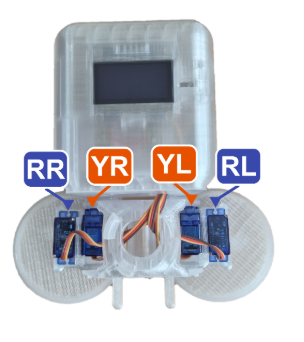
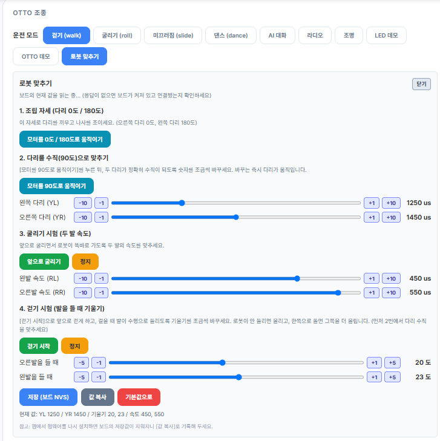
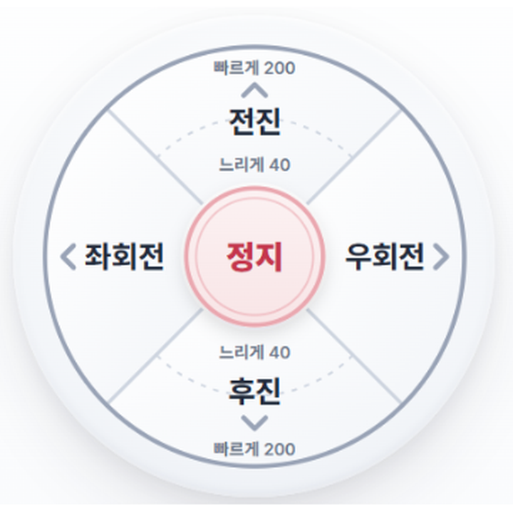
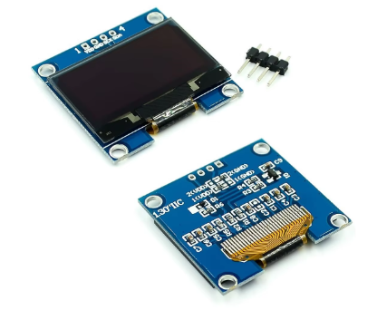
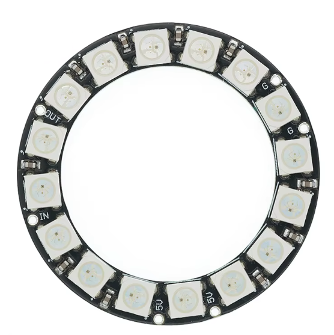

# 그림 모음

이 폴더의 그림을 한눈에 볼 수 있게 모았습니다. 그림 이름 아래의 파일 이름으로 문서에서 찾아 쓰세요.

| | | |
|:---:|:---:|:---:|
|  **Otto 사진 (흰 배경)** otto-photo-white.png |  **Otto 사진 (검은 배경)** otto-photo.png |  **Otto 서보모터 사진** otto-servos.png |
|  **Otto Ninja 서보모터 이름 (YR, YL, RR, RL, 핀 번호)** otto01.png |  **서보모터 이름 (가이드용)** otto-servos-guide.png |  **OTTO 조종 - 로봇 맞추기 화면** otto-calibration.png |
|  **OTTO 조종 패드 (전진, 후진, 좌회전, 우회전, 정지)** otto-pad.png |  **1.3" OLED LCD 128x64** oled-1.3-128x64.png |  **16구 LED 링 (WS2812B)** led-ring-16.png |
